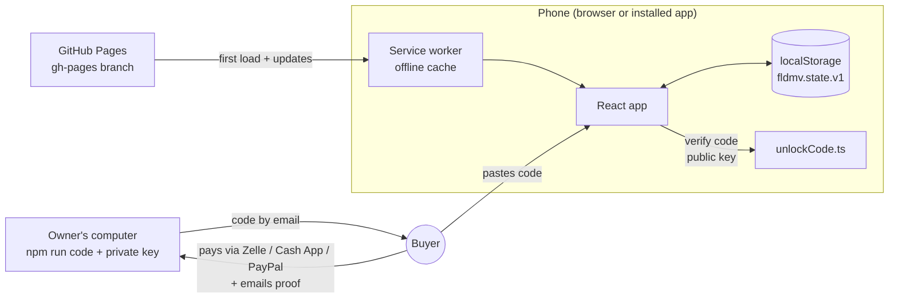
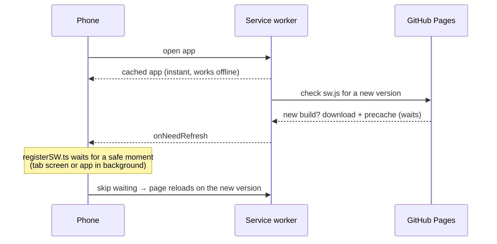

# Architecture

How the app is put together, how data flows, and where state lives. For the *why*, see
[DECISIONS.md](DECISIONS.md). For the look, see [DESIGN-SYSTEM.md](DESIGN-SYSTEM.md).

## 1. Shape of the system



There is **no server and no database**. The app is static files on GitHub Pages; everything the
user does is stored on their device. Premium is a signed code checked on the device.

## 2. Layers (dependencies point downward only)

| Layer | Folder | Rule |
|---|---|---|
| Screens | `src/ui/screens/` | React screens; read state via hooks, change it only via store actions |
| Components | `src/ui/components/`, `src/ui/icons.tsx` | presentational building blocks, no business logic |
| Routing | `src/ui/router.ts` | hash routes + back-stack helpers |
| State | `src/store/` | `appStore.ts` (persisted state + actions), `useEntitlement.ts` (derived Premium) |
| Billing | `src/billing/` | code format/crypto (`unlockCode.ts`), Premium rules (`entitlement.ts`) |
| Domain | `src/domain/` | pure functions: gating, metrics, topics, dates. No React, no browser APIs |
| Data | `src/data/` | the bundled question bank |
| Config | `src/config/` | owner-editable constants (prices, email, payment handles, public key) |
| PWA | `src/pwa/` | service-worker registration, install prompt / iOS detection |

`src/domain/` and `src/billing/unlockCode.ts` are framework-free so they can be reused (the CLI in
`tools/` imports them directly) and tested in isolation.

## 3. Data flow

```
questions.json ──► data/questions.ts ──► screens (study pool, exam samples)
                                            │ user answers
                                            ▼
                          store/appStore.ts actions (recordAnswer, recordMock, markDailyQuiz…)
                                            │ persist + notify
                                            ▼
                         localStorage "fldmv.state.v1"  ──►  useAppState() re-renders screens
                                            │
             domain/metrics.ts (mastery, pass %) and domain/gating.ts (free limits) compute views
                                            │
     store/useEntitlement.ts: unlock record + today ──► billing/entitlement.ts ──► premium yes/no
```

## 4. Persisted state (`localStorage["fldmv.state.v1"]`)

One JSON object, type `AppState` in `src/store/appStore.ts`:

| Field | Meaning |
|---|---|
| `userName` | `null` = onboarding not done; `''` = skipped; else the name for "¡Hola, …!" |
| `answers` | `{ [questionId]: boolean }` latest result per question (drives mastery %) |
| `mocks` | `[{ at, correct, total }]` finished 50-question exams, oldest first (max 100) |
| `freeDay`, `freeCount` | free study answers counted on that day (resets when the day changes) |
| `quizDay` | day of the last Daily Quiz (free users: one per day) |
| `unlock` | `{ email, code }` saved Premium activation; **re-verified on every start** |
| `installDismissed` | user hid the "Instala la app" card |
| `lastSeenDay` | latest day the app has seen (anti date-rollback, see below) |

- "Day" = the phone's **local** calendar date as `YYYY-MM-DD` (`domain/dates.ts`), but never
  earlier than `lastSeenDay` (`effectiveDay`): setting the phone's date back can't extend a monthly
  plan or reset free counters. A remembered day more than 62 days ahead of the clock is ignored
  (so a once-wrong clock can't lock an honest user out). "Today" refreshes at local midnight.
- Several copies of the app may be open (installed app + browser tab share storage). Every write
  re-reads storage first, and a `storage` event listener pulls in the other copy's changes, so a
  stale copy never overwrites newer data such as a Premium activation.
- Reset progress keeps `userName` and `unlock` (a paying user stays Premium) — same as Android.
- First run imports `answers`/`mocks` from the old web app's `fl_driver_progress` key, if present.
- If storage is blocked (private mode), the app works in memory for that session.
- Changing the shape: keep old fields readable, or add a new key (`…v2`) with a migration in `load()`.

## 5. Premium (entitlement)

`computeEntitlement(unlock, today)` in `billing/entitlement.ts` is the **only** place that decides
Premium. It verifies the saved code with the public key, then:

| Plan | Status |
|---|---|
| none / invalid code | `free` |
| lifetime | `lifetime` (forever) |
| monthly, today ≤ expires | `monthly` (`remind` = true in the last 3 days) |
| monthly, up to 3 days after expires | `monthly` with `inGrace` (still Premium, warning shown) |
| monthly, later | `expired` → free features only, progress kept, "Renovar" notice on Inicio |

Code format and the owner's workflow: [UNLOCK-CODES.md](UNLOCK-CODES.md).

## 6. Free-tier gates (`domain/gating.ts`)

| Action | Free | Where enforced |
|---|---|---|
| Study question | 5 per day | `StudyScreen` (redirects to `/paywall` when used up) |
| Daily Quiz | 1 per day | `examActions.startDailyQuiz` + `ExamScreen` (checked once on entry) |
| Full Mock (50) | blocked | `examActions.startFullMock` + `ExamScreen` (also blocks typed URLs) |

Exam/quiz answers update mastery but never spend the study allowance (`countsTowardDailyCap: false`).

## 7. Routing (`ui/router.ts`)

Hash URLs (`#/study/REGLAS`) so GitHub Pages and the offline cache always serve `index.html`.

| Route | Screen | Android equivalent |
|---|---|---|
| `/home` `/topics` `/exams` `/profile` `/settings` | tabs | NavigationBar destinations |
| `/study/:topic` | StudyScreen | `study/{topic}` |
| `/exam/5`, `/exam/50` | ExamScreen | `exam/{count}` |
| `/results/:c/:t` | ResultsScreen | `results/{c}/{t}` |
| `/paywall` | PaywallScreen | `paywall` |
| `/activate`, `/install` | web-only | — |

Back-stack behaviour (mirrors Android `popUpTo`):
- From Inicio, a tab is **pushed**; between tabs it **replaces** → Back always returns to Inicio.
- Exam → Results **replaces** the exam, so Back never re-enters a finished exam.
- The first entry of a session is marked `'root'`; `goBack()` there goes to Inicio instead of
  leaving the app. `goHome()` walks back to Inicio ("Volver al Inicio").
- When the free allowance runs out, Study **replaces** itself with the paywall, so "Ahora no"
  returns to where the user came from (avoids a paywall loop).

## 8. Offline & updates (PWA)

- `vite-plugin-pwa` (config in `vite.config.ts`) generates `manifest.webmanifest` and `sw.js`
  (Workbox). The service worker **precaches every built file** (JS, CSS, fonts, icons, the
  question bank inside the JS, `privacy-policy.html`), so after the first visit the app opens with
  no connection.
- Updates (`registerType: 'prompt'` + `pwa/registerSW.ts`): a new deploy downloads in the
  background; the app switches to it automatically at a **safe moment** — when it's in the
  background or the user is on a bottom-nav tab — never mid-exam, mid-question or while typing a
  code. Open apps check hourly. Details: [DEPLOY.md](DEPLOY.md).
- Install: Android Chrome's `beforeinstallprompt` is captured (`pwa/install.ts`) and offered as
  an "INSTALAR" button; iPhone gets illustrated Share → "Agregar a inicio" steps (`InstallScreen`).



## 9. Testing

`npm test` runs Vitest in jsdom:
- `tests/domain/` — gating, metrics, topics, dates, question bank integrity (ported from Android `MetricsTest.kt`)
- `tests/billing/` — code create/verify, tampering, forgery, wrong email, monthly expiry/grace
- `tests/store/` — persistence, daily counter, reset semantics, legacy migration
- `tests/ui/` — user journeys (onboarding, gating, paywall, activation with real signed codes,
  daily quiz) and the Spanish-chrome guard

Visual checks: `npm run shots` (see [DESIGN-SYSTEM.md](DESIGN-SYSTEM.md#checking-parity)).
